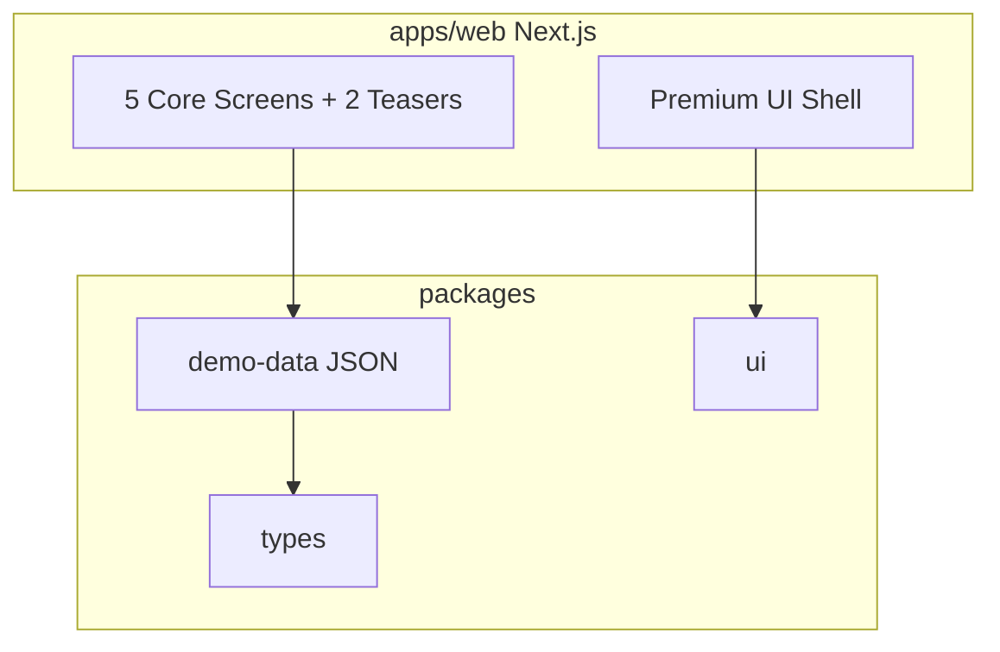
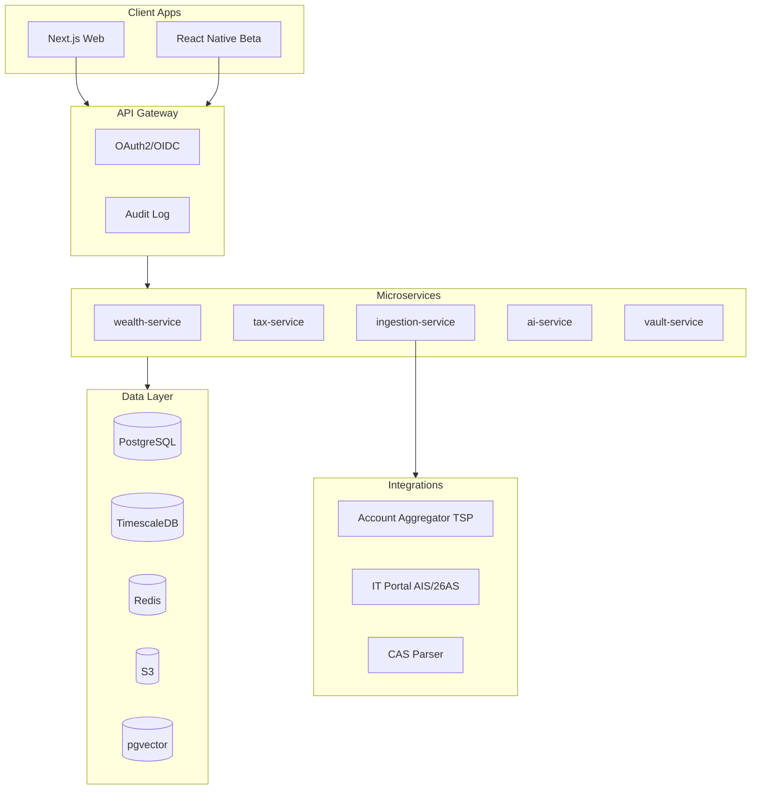

# CAPSTONE — Architecture & Post-Demo Roadmap

Maps the 2-week investor demo to the [90-day MVP plan](product-bible.md) in the Project Bible (§15).

**Doc index:** [`README.md`](README.md) · **Master build plan:** [`build-plan.md`](build-plan.md) · **Tech plan:** [`tech-plan.md`](tech-plan.md) · **CA Buddy brain:** [`ca-buddy.md`](ca-buddy.md) · **Launch gates:** [`launch-checklist.md`](launch-checklist.md)

**Foundation:** All services and integrations must comply with [Anti-Goals](anti-goals.md) (§0 in Bible) — observation/orchestration only, no execution layer.

## Current state (Demo)



- **No live integrations** — all data from `packages/demo-data`
- **Auth:** Cookie-based demo gate (`capstone2026`)
- **State:** Action Card done/dismissed in `localStorage`
- **Exports:** Client-side PDF via jsPDF

## Target architecture (90-day MVP)

From Bible §8:



**Recommended stack:** Next.js · NestJS · PostgreSQL + TimescaleDB · Redis/BullMQ · AWS ap-south-1

## Migration path: Demo → Production

### Phase 0 — Demo (Weeks 1–2) ✅

| Component | Implementation |
|-----------|----------------|
| God Mode UI | Seeded `family.json` + `holdings.json` |
| Tax Firewall UI | Seeded `firewall.json` |
| Action Cards | Seeded `action-cards.json` + localStorage |
| ARCHITECT | Pre-authored `architect-responses.json` |
| PDF export | jsPDF client-side |

### Sprint 1 — Days 1–30

Replace fixtures with live data for **single person + AA**:

1. Add `apps/api` (NestJS) with `wealth-service` skeleton
2. Integrate Account Aggregator via TSP (bank + MF + demat)
3. User auth (OAuth2), family/entity setup
4. God Mode Dashboard reads from PostgreSQL, not JSON
5. Keep `packages/demo-data` for offline demos

**Key APIs:**
- `GET /family/networth`
- `GET /entities/{id}/holdings`
- `POST /ingest/aa/consent`

### Sprint 2 — Days 31–60

Tax core:

1. CAS import (Zerodha, Groww) for lot-level cost basis
2. Tax ledger — STCG/LTCG calculation engine
3. Tax Firewall v1 — manual AIS upload → diff engine
4. Free Money Button v1 — harvest scan + Action Card generation

**Key APIs:**
- `GET /tax/firewall/status`
- `POST /tax/harvest/scan`
- `POST /ingest/cas`

**Swap in UI:** Replace static `firewall.json` with API; Action Cards generated server-side.

### Sprint 3 — Days 61–90

AI + polish:

1. ARCHITECT v1 — RAG over legal corpus + user portfolio (pgvector)
2. Advance tax projection
3. Nominee audit (manual entry)
4. Mobile beta (React Native)
5. 10 pilot families

**Key APIs:**
- `POST /ai/ask`
- `POST /ai/scenario`

**Swap in UI:** ARCHITECT calls `ai-service` instead of seeded responses.

### Phase 2 — Months 12–24 (Bible §14)

- Full entity graph (HUF, trust automation)
- Honesty Check (manager scorecard)
- Time Machine (scenario engine)
- If I'm Gone Vault
- Advisor Mesh (CA/RM scoped access)

## Data model

Core entities from Bible §10 — already typed in `packages/types`:

```
Family → Person | LegalEntity → Asset → Lot[]
TaxLedger → ais_entries[], mismatches[]
ActionCard → type, savings_inr, instructions
```

Entity graph example in `packages/demo-data/src/family.json`.

## Background jobs (production)

| Job | Frequency | Purpose |
|-----|-----------|---------|
| aa-sync | Every 6h | Refresh AA data |
| ais-reconcile | Nightly | Tax Firewall scan |
| harvest-scan | Daily | Harvest opportunities |
| price-update | 15 min | Mark-to-market |
| nominee-audit | Weekly | Nominee status |

## Security posture

| Measure | Demo | Production |
|---------|------|------------|
| Encryption at rest | N/A | AES-256 AWS KMS |
| PII isolation | Sample data | Schema per family |
| IT portal creds | N/A | Encrypted, consent-bound |
| Data residency | Local | AWS ap-south-1 |

## What stays unchanged in migration

- `packages/types` — extend, don't rewrite
- `packages/ui` — design system carries forward
- Page routes and information architecture
- Action Card UX pattern

## Repository layout (target)

```
HNI/
├── apps/
│   ├── web/              # Next.js (exists)
│   ├── api/              # NestJS gateway + services (Sprint 1)
│   └── mobile/           # React Native (Sprint 3)
├── packages/
│   ├── demo-data/        # Keep for demos
│   ├── types/
│   ├── ui/
│   └── ca-buddy/         # Brain: calculators, evals, orchestrator (Sprint 2+)
└── infra/                # Terraform, Docker (Sprint 1)
```

## Success metrics (from Bible §16)

| Metric | Month 6 target |
|--------|----------------|
| Families onboarded | 50 |
| Weekly active rate | 45% |
| Tax documented saved | ₹5 Cr cumulative |
| Firewall mismatches caught | 200 |

---

*This document should be updated when Sprint 1 begins. Product decisions trace to the [Project Bible](product-bible.md) and [Anti-Goals Constitution](anti-goals.md).*
