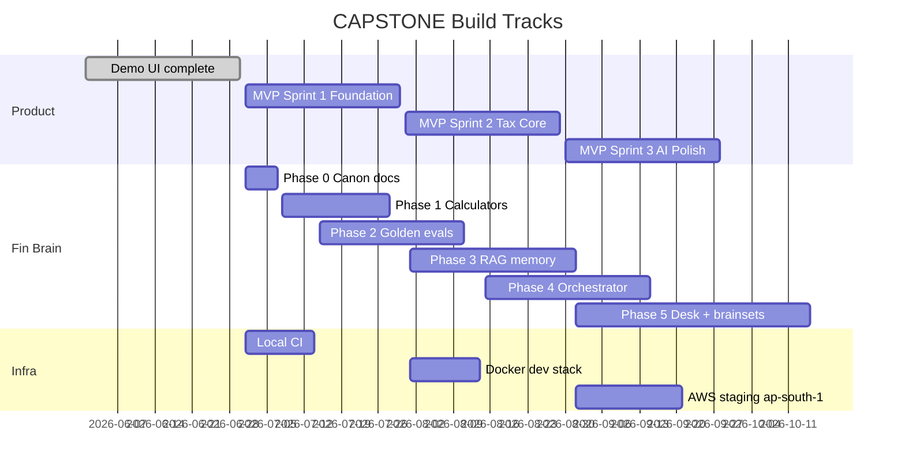

# CAPSTONE Master Build Plan

**Status:** Canonical execution sequence for the entire project.  
**Audience:** Founders, engineers, coding agents.  
**Companion docs:** [`product-bible.md`](product-bible.md) (what), [`tech-plan.md`](tech-plan.md) (how), [`ca-buddy.md`](ca-buddy.md) (AI mind), [`launch-checklist.md`](launch-checklist.md) (ship gates).

---

## North star

Ship an **HNI wealth command layer** (₹5Cr–₹100Cr+ entity webs) that:

- Unifies family wealth across entities and held-away assets
- Catches tax mismatches before notices (Tax Firewall)
- Surfaces tax-saving opportunities (Free Money Button / harvest)
- Runs **Fin** (main buddy): on-demand answers **and** a proactive CA-style operating desk
- Surfaces chat via **ARCHITECT** (calls Fin); CA / family / other agents call the same Fin
- Outputs **Action Cards** — instructions only, never execution; desk plans need **CA then HNI** approval

Everything passes [`anti-goals.md`](anti-goals.md). When in doubt, refuse and propose an in-lane alternative.
See visual map: [`mastery.md`](mastery.md).

---

## Build tracks (parallel but ordered)

Three tracks run together; dependencies are strict within each track.



---

## Track A — Product (90-day MVP)

From [`product-bible.md`](product-bible.md) §15 and [`architecture.md`](architecture.md).

### Phase A0 — Demo (complete)

| Deliverable | Status | Artifact |
|-------------|--------|----------|
| Portal picker + 6 core screens | Done | `apps/web` |
| Kapoor family fixtures | Done | `packages/demo-data` |
| ARCHITECT seeded responses | Done | `architect-responses.json` |
| Action Cards + localStorage state | Done | `use-action-cards.ts` |
| PDF export | Done | `pdf-export.ts` |

### Phase A1 — Foundation (Days 1–30)

**Goal:** One real person + Account Aggregator → God Mode reads from DB.

| # | Task | Done when |
|---|------|-----------|
| A1.1 | NestJS `apps/api` skeleton + health check | ✅ `GET /health` returns 200 |
| A1.1b | Fin ask endpoint + ARCHITECT BFF | ✅ `POST /ai/ask` + web `/api/ai/ask` (demo JSON fallback) |
| A1.2 | OAuth2/OIDC auth, family + entity CRUD | ✅ JWT auth + family/person/entity CRUD (OIDC IdP before pilots) |
| A1.3 | PostgreSQL schema: Family, Person, LegalEntity, Asset | ✅ Prisma schema + migrations (SQLite local; PG Docker optional) |
| A1.4 | AA integration via TSP (consent flow) | ✅ Simulated AA consent-shaped API (`POST /ingest/aa/consent`) |
| A1.5 | God Mode API | ✅ `GET /family/networth` from DB |
| A1.6 | Keep demo fixtures | ✅ `packages/demo-data` unchanged for offline demos |

**Do not start:** HUF/trust automation, IT portal API, mobile app.

### Phase A2 — Tax Core (Days 31–60)

**Goal:** Real tax ledger + Firewall + harvest Action Cards.

| # | Task | Done when |
|---|------|-----------|
| A2.1 | CAS import (Zerodha, Groww) | ✅ `POST /ingest/cas` lot-level tax ledger |
| A2.2 | STCG/LTCG engine in `packages/ca-buddy` | ✅ Unit tests + used by ingestion |
| A2.3 | Tax Firewall v1 | ✅ AIS fixture upload → mismatch list |
| A2.4 | Free Money Button v1 | ✅ `POST /tax/harvest/scan` → server Action Cards |
| A2.5 | UI swap | ✅ Firewall + Actions read API when `NEXT_PUBLIC_USE_LIVE_API=true` |

**Do not start:** ITR e-filing, product recommendations, auto-execution.

### Phase A3 — AI + Polish (Days 61–90)

**Goal:** ARCHITECT live with portfolio context; 10 pilot families.

| # | Task | Done when |
|---|------|-----------|
| A3.1 | `ai-service` + Fin orchestrator | ✅ `POST /ai/ask` returns cited answers |
| A3.2 | ARCHITECT UI calls Fin API | ✅ Demo JSON fallback only when API unavailable |
| A3.3 | Advance tax projection | ✅ `POST /tax/advance-tax` via Fin calculators |
| A3.4 | Nominee audit (manual entry) | ✅ `GET /vault/nominee-audit` → Action Cards |
| A3.5 | Mobile beta (React Native) | Deferred — documented |
| A3.6 | 10 pilot families onboarded | Ops gate — not engineering |

---

## Track B — Fin brain

Full detail in [`ca-buddy.md`](ca-buddy.md) (Fin architecture) and [`ca-buddy-training.md`](ca-buddy-training.md).  
Visual map: [`mastery.md`](mastery.md).

| Phase | Name | Duration | Exit criteria |
|-------|------|----------|---------------|
| **B0** | Canon + constitution | Week 0 | Docs + `ARCHITECT_RULES` encoded; refuse taxonomy defined; Fin named in mastery |
| **B1** | Deterministic calculators | Weeks 1–3 | Slabs, CG, advance tax, 54F stub — 100% unit test coverage on P0 calcs |
| **B2** | Golden eval harness | Weeks 2–4 | ≥20 HNI scenarios; ≥90% pass on deterministic subset in CI |
| **B3** | Regulatory RAG | Weeks 4–8 | pgvector corpus; cite-or-refuse; no uncited tax claims in eval |
| **B4** | Orchestrator + sub-buddies | Weeks 6–10 | Intent routing; Mode A/B; Action Card / consult-CA endings |
| **B5** | Brainsets + operating desk | Months 3–4 | ✅ Per-portfolio brainset from DB; Day Plan persist; CA → HNI APIs; BullMQ/Redis scheduler (fallback interval) |
| **B6** | Deep mind | Months 6–18 | Case law, FEMA, trusts; scheduled sub-buddies; optional fine-tune **only after** eval ceiling |

**Hard rule:** B1 + B2 before B3. B3 before live Fin swap (A3.1). Fine-tune (B6) is last.

**Brainset readiness (design now, wire accounts later):** contracts for brainset ID, calendar, Day Plan, CA/HNI approval states — no real PII in repo; demo brainset from Kapoor fixtures.

---

## Track C — Infrastructure

Detail in [`tech-plan.md`](tech-plan.md).

| Phase | Where | Deliverable |
|-------|-------|-------------|
| C0 | Local + GitHub Actions | CI: typecheck, lint, calculator tests, eval subset |
| C1 | Local Docker | Postgres + pgvector + Redis for RAG dev |
| C2 | AWS `ap-south-1` staging | `ai-service`, RDS, S3 corpus, secrets in KMS |
| C3 | AWS production | Same as staging; pilot families; audit logs |

---

## Cross-track dependencies

```
A1 (API + DB) ──────────────────────────► A2 (tax-service)
B1 (calculators) ──► A2.2 (STCG/LTCG) ──► A2.4 (harvest)
B2 (evals) ──► B3 (RAG) ──► B4 (orchestrator) ──► A3.1 (Fin live via ARCHITECT)
B5 (brainsets + desk) ──► CA→HNI Day Plan approval + unique calendars
C1 (Docker) ──► B3 (local RAG dev)
C2 (staging) ──► A3.1 + B5 (integration testing)
```

**Never:** Wire ARCHITECT / Fin to a raw LLM without B1 calculators + B2 eval gates.

---

## Post-MVP roadmap (Phase 2 product)

From [`product-bible.md`](product-bible.md) §14 — after 90-day MVP:

| Feature | Depends on |
|---------|------------|
| Full entity graph (HUF, trust automation) | A1 schema + B5 context |
| Honesty Check (manager scorecard) | A1 holdings + benchmarks |
| Time Machine (scenario engine) | B1 calculators + B4 Fin orchestrator |
| If I'm Gone Vault | vault-service + consent model |
| Advisor Mesh (CA/RM scoped access) | advisor-service + audit log |

---

## Definition of done (project milestones)

### Milestone 1 — Foundation brain (Week 4)

- [ ] `docs/` bible complete (this doc suite)
- [ ] `packages/ca-buddy` with P0 calculators + tests
- [ ] Golden eval harness in CI
- [ ] Anti-goal phrase linter (or manual checklist in CI)

### Milestone 2 — MVP tax core (Day 60)

- [ ] Live Firewall + harvest from real/simulated AIS
- [ ] Action Cards generated server-side
- [ ] Calculators shared by tax-service and Fin (`packages/ca-buddy`)

### Milestone 3 — MVP launch (Day 90)

- [ ] Fin live on staging with portfolio brainset context (ARCHITECT + desk path stub)
- [ ] 10 pilot families
- [ ] [`launch-checklist.md`](launch-checklist.md) MVP section all checked

### Milestone 4 — Production brain (Month 6)

- [ ] Operating desk: daily Day Plan → CA → HNI
- [ ] Unique FY/Q calendar per brainset
- [ ] RAG corpus refreshed via staging review pipeline
- [ ] Red-team eval suite green
- [ ] Mode B structuring memos with multi-law citations (B6 partial)

---

## Explicitly NOT in scope (ever)

See [`anti-goals.md`](anti-goals.md). Summary:

- ITR e-filing · mass-market retail product · MF/insurance distribution
- Trade execution · lending · custody · auto-run Action Cards
- Binding legal advice · audit immunity guarantees
- Training on customer PII without opt-in · data outside India

---

## How to use this doc while vibe coding

1. Identify which **track + phase** your task belongs to.
2. If the task isn't listed in the current phase, **stop** — either defer or update this doc in the same PR with justification.
3. Check **cross-track dependencies** before integrating (e.g. don't call LLM for tax numbers before B1 exists).
4. Mark tasks done only when **exit criteria** met, not when code "kind of works."
5. Before any external launch, run [`launch-checklist.md`](launch-checklist.md).

*Canonical build sequence — update when sprints shift; product vision changes go through product-bible first.*
