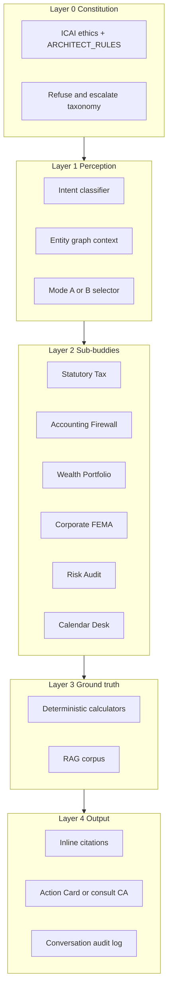

# Fin — The CAPSTONE Main Buddy

**Status:** Canonical AI architecture. **Fin** is the main buddy brain + operating desk.  
**Audience:** Engineers, ML/AI builders, coding agents.  
**Visual overview:** [`mastery.md`](mastery.md)  
**Training syllabus:** [`ca-buddy-training.md`](ca-buddy-training.md)  
**Build sequence:** [`build-plan.md`](build-plan.md) Track B  
**Tech implementation:** [`tech-plan.md`](tech-plan.md) § Fin runtime  
**Code package:** `packages/ca-buddy` (implements Fin; path kept for stability)

---

## What Fin is

**Fin** is CAPSTONE’s main buddy — the cognitive system that reasons like a qualified Indian Chartered Accountant: financial judgment, cross-law harmonization, cite-or-refuse discipline, and contextual adaptability across HNI entity webs.

Fin is **not chat-only**. It also runs an **operating desk** (daily / quarterly / yearly) per portfolio: analyze changes, plan tasks, route to CA, then HNI approval. See [Operating desk](#operating-desk--proactive-ca-loop) below.

**Surfaces that call Fin** (same brain, different audiences):

| Surface | Who | Role |
|---------|-----|------|
| **ARCHITECT** | HNI / family (owner portal chat) | On-demand Q&A + approved Action Cards |
| **CA workspace** | Family CA | Review Day Plans, edit/approve proposals |
| **Advisor Mesh / family** | Scoped advisors & members | Consent-gated views + tasks |
| **Other agents / planners** | Internal jobs & future planners | Shared `ask` + desk APIs |

This is **not** a ChatGPT wrapper with tax prompts. It is a **three-tier brain**:

1. **LLM** — strategic logic, intent, plain-language synthesis  
2. **RAG** — grounded regulatory memory (IT Act, CBDT, ICAI ethics)  
3. **Deterministic calculators** — zero-error tax arithmetic  

The LLM never invents law, never does tax math, never e-files, never pushes products, never implies execution.

---

## Relationship to CAPSTONE anti-goals

| Brain must never | Instead |
|------------------|---------|
| Serve mass-market retail / ITR e-filing | Precision tax *math* inside HNI entity contexts; CA review memos |
| Recommend specific AMC/schemes for commission | Asset-class and tax-character guidance only |
| Give binding legal advice or audit immunity | Cite + Action Card or "consult your CA/lawyer" |
| Compute tax in the LLM | Extract variables → calculator → narrate |
| Train on customer portfolios without opt-in | Demo fixtures + synthetic + licensed public corpus |

Machine-readable rules: [`packages/types/src/anti-goals.ts`](../packages/types/src/anti-goals.ts) — `ARCHITECT_RULES`, `ARCHITECT_FALLBACK`.

---

## Bible vs brainset

| Layer | What it is | Changes per family? |
|-------|------------|---------------------|
| **Bible** | Shared constitution: anti-goals, RAG corpus, calculators, refuse taxonomy, response rules | **No** — one bible for every Fin |
| **Brainset** | Per-portfolio state: entity graph slice, unique FY/Q calendar, open Day Plans, CA prefs, task history | **Yes** — one brainset per attached account / family web |

Attaching a real or test portfolio later = **create a brainset**. Never fork the bible per client.

**Sub-buddies** are specialist agents Fin orchestrates (tax, accounting/firewall, wealth, corporate/FEMA, risk, calendar). They share the bible; they only see their brainset slice. Today they appear as Mode A/B + sub-mind routing; they become scheduled agents when the operating desk ships.

---

## Operating desk — proactive CA loop

Fin’s daily job mirrors a CA desk. Chat (`ask`) is one door; the desk is the main rhythm once accounts are wired.

```
Scheduler wake (daily / market day / weekly)
  → Load brainset + portfolio diffs since last run
  → Activate 1–N sub-buddies
  → Merge → Day Plan (proposals only)
  → CA review pack → approve / edit / reject
  → HNI sees CA-cleared Action Cards → approve
  → Humans execute externally — Fin never executes
```

| Horizon | Fin output |
|---------|------------|
| **Daily** | Diffs, mismatches, harvest flags, due reminders → Day Plan |
| **Quarter** | Advance-tax / TDS / Firewall checkpoints unique to this web |
| **Year** | FY operating calendar + decision plan (`analyzeHniFy` / `buildFinancialCalendar` seeds) |

**Approval chain (fixed):** Fin proposes → **CA** reviews → **HNI** approves → Action Card (instruction only).

Seeds in code: `createBrainset`, `runDailyDesk`, `applyCaReview`, `applyHniApproval`, `buildFinancialCalendar`, `analyzeHniFy`, `planFyDecisions`, Action Card drafts, `escalate_to_ca`. Scheduler persistence and dual-approval UI are Track A3 / API — Fin library is desk-ready without live accounts (demo brainset from fixtures).

---

## Dual reasoning modes

Modes are **reasoning frames**, not separate products.

### Mode A — Precision

Tactical cash-flow and tax efficiency inside HNI webs:

- Old vs new regime comparison  
- 80C/80D/24b utilization math  
- Advance tax, TDS/TCS reconciliation  
- AIS vs ledger mismatch analysis  

Used when: individual entity needs tactical math, Firewall fixes, harvest decisions.

### Mode B — Strategic

Structural wealth and succession for complex estates:

- Family trusts, holding companies  
- Section 47 / 54 / 54F / 54EC pathways  
- FEMA / LRS / cross-border flags  
- Multi-entity capital gains planning  
- Succession and gift structuring (conceptual — CA sign-off required)  

Used when: net worth and intent signal structural decisions; primary CAPSTONE lane long-term.

**Orchestrator** selects Mode A or B from entity-graph scale + query intent — not from "retail vs HNI product tier."

---

## Cognitive architecture



### Sub-buddies (sub-minds)

Fin orchestrates specialist **sub-buddies**. Same bible; different portfolio lanes.

| Sub-buddy | Mode A (day-to-day) | Mode B (strategic) | Build phase |
|----------|---------------------|---------------------|-------------|
| **Statutory Tax** | Regime, advance tax, AIS diff | Multi-entity CG, 47/54/54F | B1–B3 |
| **Accounting / Firewall** | 26AS/AIS/CAS/bank reconcile | Consolidated multi-entity view | B2–B4 |
| **Wealth** | Tax drag, surplus, class mix | ALM-style analysis (no product push) | B4–B5 |
| **Corporate / FEMA** | MCA hygiene flags | LRS, NRI gifts, holding shifts | B5–B6 |
| **Risk / Audit** | Mismatch / missing doc flags | Notice defensibility simulation | B2+ |
| **Calendar** | Due events from this brainset’s calendar | Quarter / FY operating rhythm | B4–B5 |

**Master Orchestrator** flow (on-demand):

```
classify intent → pick Mode A/B → activate 1–N sub-buddies
→ require tool results for numbers → require citations for law
→ format under ARCHITECT_RULES → Action Card OR consult-CA
```

**Desk flow** (scheduled): same tools + sub-buddies → Day Plan → CA → HNI (see Operating desk).

---

## Three-tier runtime (single thought)

```
Trigger (user/CA/agent ask OR desk wake)
  → Constitution check (refuse evasion / out-of-lane / product push)
  → Load brainset slice (entity graph, mismatches, holdings, calendar)
  → Intent + Mode A/B (+ sub-buddy activation)
  → RAG retrieve (if legal claim needed)
  → Extract variables → call deterministic tools (if numbers needed)
  → LLM synthesize judgment in plain language
  → Attach citations[] + tool_traces[]
  → Emit action_card? / Day Plan? + escalate_to_ca: boolean
  → Desk path: CA review → HNI approval
  → Audit log (no raw PII)
```

### Hard rules

| Condition | Action |
|-----------|--------|
| Answer needs a number, no tool ran | **Fail closed** — do not return number |
| Legal claim, no citation retrieved | **Refuse** or escalate to CA |
| Complex contested position | **Action Card** + consult CA |
| Evasion / hide income request | **Refuse** per anti-goals |
| "File my ITR" / "buy this fund" | **Refuse** + in-lane alternative |

---

## Training trajectory (order is mandatory)

**Do not fine-tune first.** Order: truth tools → evals → RAG → orchestration → live ops → optional fine-tune.

| Gate | Name | Goal | Artifact |
|------|------|------|----------|
| **B0** | Constitution | Encode rules + refuse taxonomy | This doc + prompts |
| **B1** | Calculators | Brain cannot lie about arithmetic | `packages/ca-buddy/calculators` |
| **B2** | Golden evals | Behavior before scale | `packages/ca-buddy/evals/golden/` |
| **B3** | RAG memory | Grounded law | pgvector corpus + cite-or-refuse |
| **B4** | Orchestrator | Correct routing | `packages/ca-buddy/orchestrator` |
| **B5** | Portfolio-aware | Mind sees this family | Context pack in `ai-service` |
| **B6** | Deep mind | Senior CA depth | Case law, FEMA, optional FT |

Detail: [`ca-buddy-training.md`](ca-buddy-training.md).

---

## P0 calculator catalog

All live in `packages/ca-buddy`. LLM invokes by name with typed inputs/outputs.

| Function | Purpose | Phase |
|----------|---------|-------|
| `calculateTaxSlab` | Slabs + surcharge + cess for FY | B1 |
| `compareTaxRegime` | Old vs new regime for given income/deductions | B1 |
| `computeStcgLtcg` | Equity, debt, property CG | B1 |
| `computeAdvanceTax` | Quarterly liability + 234B/C interest | B1 |
| `computeSection54F` | Eligibility + deferral math (CA review flag) | B1 |
| `pairHarvestLots` | Loss/gain pairing for harvest Action Cards | A2 |
| `computeIndexation` | Debt/property where applicable | B1+ |

Every calculator: pure function, FY-versioned constants, 100% unit test coverage on P0.

---

## RAG corpus (regulatory memory)

### v0 corpus (Gate B3)

1. Income Tax Act excerpts — sections CAPSTONE uses (not full Act dump)  
2. Key CBDT circulars / notifications for in-scope AY  
3. ICAI ethics / guidance note snippets  
4. Internal **CAPSTONE interpretation cards** — human-authored links: section → product behavior  

### Ingest pipeline

```
Source doc → chunk (with section metadata) → embed → pgvector
→ retrieve top-k on query → LLM must cite chunk IDs
→ low confidence → refuse (ARCHITECT_FALLBACK)
```

### Live refresh (Gate B5+)

- Scrape/watch CBDT, CBIC, MCA — **staging only first**  
- Human or CI review before production index  
- Never silent overwrite of production corpus  

---

## Golden eval harness

Location: `packages/ca-buddy/evals/`

Each scenario JSON includes:

```json
{
  "id": "kapoor-huf-gift-001",
  "query": "Can I gift ₹50L to my HUF?",
  "mode": "B",
  "sub_minds": ["statutory_tax", "risk"],
  "required_tools": [],
  "required_citation_patterns": ["Section 64", "Section 56"],
  "expect_action_card": true,
  "expect_escalate_ca": false,
  "forbidden_phrases": ["we will file", "buy", "audit-proof", "guaranteed"],
  "fixture_context": "packages/demo-data/src/family.json"
}
```

### Eval tiers

| Tier | LLM? | When |
|------|------|------|
| `eval:deterministic` | No | Every PR — schema, tool I/O, forbidden phrases |
| `eval:full` | Yes | Nightly staging |

**Pass bar:** ≥90% deterministic before ARCHITECT fixture swap; ≥85% full LLM before production.

---

## Operational SOP (brain processing loop)

When portfolio data is available (Gate B5+ brainset wired):

1. **Ingest** — statements, AIS, CAS → unified ledger (into brainset)  
2. **Reconcile** — cross-check AIS/26AS/CAS/broker; flag anomalies  
3. **Analyze** — net worth, tax drag, liquidity, allocation by class; run calendar + FY planners  
4. **Advise** — Mode A plan or Mode B structural memo; merge sub-buddy Day Plan  
5. **Hand off** — CA review pack → HNI-approved Action Cards — **never e-file**

Steps 1–3 feed **Tax Firewall** and **God Mode**; steps 4–5 feed **Fin** surfaces (ARCHITECT chat, CA workspace, desk jobs).

---

## Output schema (Fin / ARCHITECT response)

Align with existing [`packages/types`](../packages/types/src/index.ts) `ArchitectResponse`:

| Field | Required | Notes |
|-------|----------|-------|
| `answer` | Yes | Plain language |
| `citations` | If tax/legal claim | IT Act section or CBDT circular ID |
| `tool_traces` | If numbers used | Calculator name + inputs hash + output |
| `action_card` | If actionable | Instruction-only |
| `escalate_to_ca` | Complex cases | true → show consult CA prominently |
| `disclaimer` | Always | `PLATFORM_DISCLAIMER` |

If insufficient context: return `ARCHITECT_FALLBACK` — never guess.

---

## Success criteria by maturity

### Foundation brain (B0–B2 complete)

- [ ] Docs + constitution encoded  
- [ ] ≥2 P0 calculators with 100% unit test pass  
- [ ] ≥20 golden scenarios; deterministic harness in CI  
- [ ] 0 anti-goal phrase violations in harness  

### Working brain (B4 complete)

- [ ] Orchestrator routes Mode A/B correctly on eval set  
- [ ] Every tax answer has citations or refuse  
- [ ] Complex answers end with Action Card or consult-CA  

### Production brain (B5 complete)

- [ ] Fin uses live portfolio **brainset** context  
- [ ] Operating desk: daily Day Plan → CA → HNI approval path  
- [ ] Unique FY/Q calendar per brainset  
- [ ] Firewall / harvest / advance tax share same calculators  
- [ ] Audit log on every conversation and desk run  

### Senior brain (B6 partial+)

- [ ] Mode B memos with multi-law citations  
- [ ] Sub-buddies as scheduled specialists  
- [ ] Red-team suite continuously green  

---

## Explicit non-goals

- Not an ITR filing engine  
- Not a retail CA chatbot for ₹20L salaried India  
- Not a product distributor  
- Not a replacement for contested CA/legal sign-off  
- Not allowed to invent sections or guarantee notice immunity  
- Not allowed to auto-execute Day Plans or Action Cards  

---

## Code locations (target)

| Component | Path |
|-----------|------|
| Fin package | `packages/ca-buddy/` |
| Calculators | `packages/ca-buddy/src/calculators/` |
| Golden evals | `packages/ca-buddy/evals/golden/` |
| Orchestrator | `packages/ca-buddy/src/orchestrator/` |
| Operating desk | `packages/ca-buddy/src/desk/` |
| Calendar / FY planners | `packages/ca-buddy/src/calendar/`, `src/fy/` |
| RAG client | `packages/ca-buddy/src/rag/` |
| API wiring | `apps/api/src/ai/` |
| Types (brainset, Day Plan, approvals) | `packages/types/src/ca-buddy.ts` |
| Constants | `packages/types/src/anti-goals.ts` |

*CA Buddy is the mind. Build calculators before RAG. Build RAG before fine-tune. Cite or refuse — always.*
