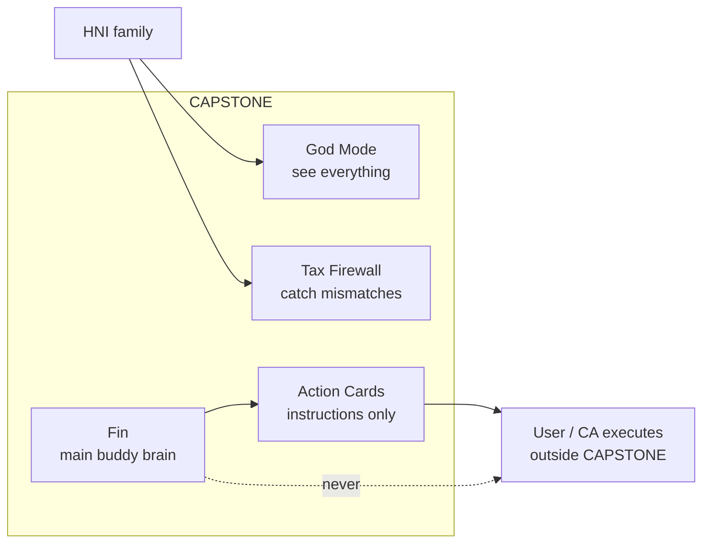
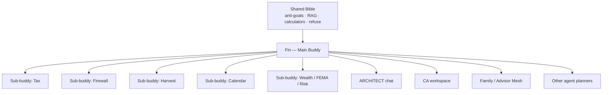
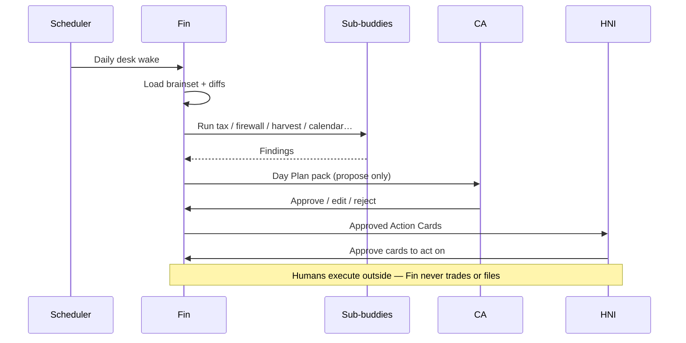
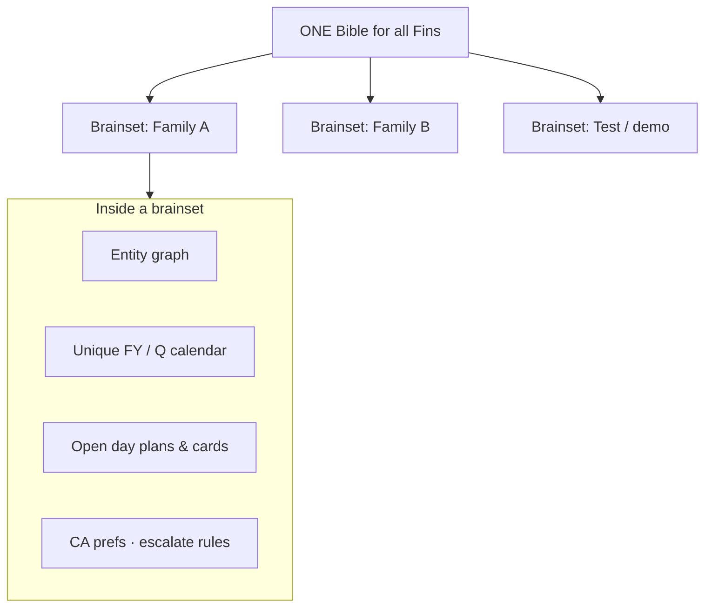
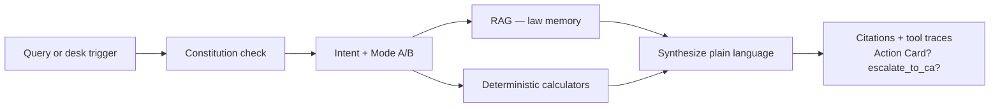
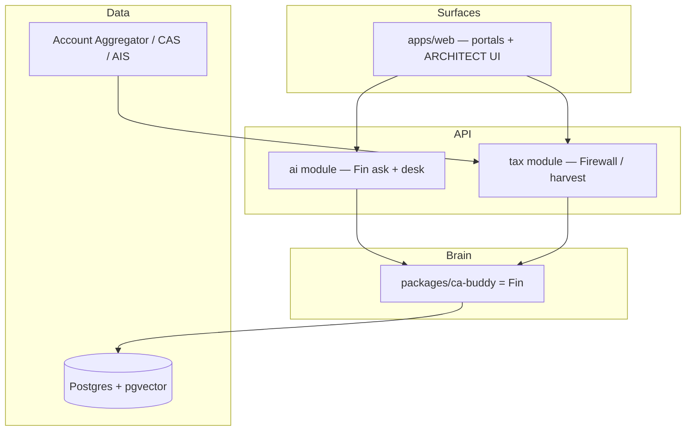
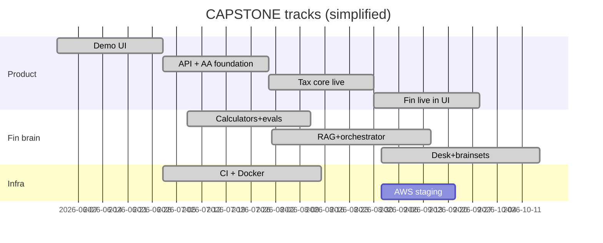
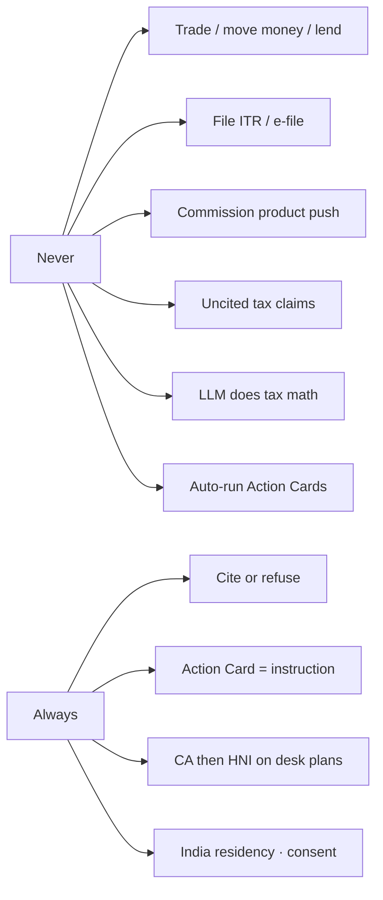

# CAPSTONE Mastery Map

**Purpose:** One visual doc to understand the whole project — product, brain (**Fin**), build order, and what is live vs later.  
**Audience:** Founders, engineers, coding agents, CAs reviewing the vision.  
**Rule:** If this conflicts with a specialist doc, the specialist wins for detail — then update *this* map in the same PR.

| Want… | Go to |
|-------|--------|
| Full picture (start here) | **This doc** |
| Legal never-dos | [`anti-goals.md`](anti-goals.md) |
| Product vision & features | [`product-bible.md`](product-bible.md) |
| What to build when | [`build-plan.md`](build-plan.md) |
| Stack & services | [`tech-plan.md`](tech-plan.md) |
| Fin brain detail | [`ca-buddy.md`](ca-buddy.md) |
| Ship gates | [`launch-checklist.md`](launch-checklist.md) |

---

## 1. What CAPSTONE is (one sentence)

An **HNI wealth command layer** for India: unify the family entity web, catch tax mismatches early, surface tax-saving opportunities, and run day-to-day wealth ops through **Fin** — without ever trading, lending, filing ITR, or selling products for commission.



---

## 2. Naming (memorize this)

| Name | Role |
|------|------|
| **CAPSTONE** | The product / platform |
| **Fin** | The **main buddy** — brain + operating desk for every portfolio |
| **Sub-buddies** | Specialist agents Fin runs (tax, firewall, harvest, calendar, FEMA, risk…) |
| **ARCHITECT** | Owner-portal **chat surface** that talks to Fin |
| **Brainset** | Per-family / per-portfolio memory & calendar (same bible, different book) |
| **Bible** | Shared constitution: anti-goals, RAG law, calculators, refuse rules |
| **Action Card** | Instruction for a human to do something externally — never auto-run |
| `@capstone/ca-buddy` | **Code package** that implements Fin (path kept for stability) |



---

## 3. Fin is not “chat only”

Fin works like a **CA’s daily desk**, not a bot you only poke.

| Mode | When | What Fin does |
|------|------|----------------|
| **On-demand** | Someone asks | Classify → RAG / calculators → cited answer → Action Card or escalate |
| **Operating desk** | Schedule (daily / market / weekly) | Diff portfolio → run sub-buddies → **Day Plan** → CA review → HNI approval |
| **Horizon plan** | Quarter / year | Unique financial calendar + operating plan for *that* brainset |



**Approval chain (fixed):** Fin proposes → **CA** reviews → **HNI** approves → Action Card (external execution).

---

## 4. Same bible, separate brainsets



- Attach a real or test portfolio **later** → create a brainset; do **not** fork the bible.
- Sub-buddies share the bible; they only see the slice of the brainset they own.

---

## 5. Three-tier brain (how Fin thinks)



| Tier | Job | Never |
|------|-----|-------|
| Calculators | Exact tax math | Invented numbers in the LLM |
| RAG | Cite IT Act / CBDT / ICAI | Uncited tax claims |
| LLM | Intent + narration | Math, filing, product push, execution |

---

## 6. How CAPSTONE fits together



**Today:** Track A + Track B (through B5) shippable locally — Fin brainsets from DB, desk CA→HNI, RAG corpus persisted, BullMQ desk scheduler, conversation audit, rate-limited ask.  
**Next:** Optional live LLM key; AWS `ap-south-1` staging; real TSP AA; pilot onboarding.  
**Later:** B6 fine-tune only after eval ceiling; Phase 2 product surfaces.

---

## 7. Build tracks (where we are)



| Track | Meaning |
|-------|---------|
| **A — Product** | UI, API, AA, Firewall, harvest, live ARCHITECT |
| **B — Fin** | Calculators → evals → RAG → orchestrator → portfolio desk → deep mind |
| **C — Infra** | CI, Docker, India-region staging/prod |

Detail and exit criteria: [`build-plan.md`](build-plan.md).

---

## 8. What’s built vs not (honest snapshot)

| Area | Status |
|------|--------|
| Demo portals + Action Cards UI | Done (fixtures + live fallback) |
| Fin calculators + golden evals | Done (34/34 deterministic) |
| Fin local RAG + orchestrator `ask()` | Done (+ corpus persisted to DB) |
| FY calendar + decision planner | Done |
| Brainset + Day Plan + CA→HNI approvals | **Done** (persisted + APIs + scheduler) |
| Nest `apps/api` Track A+B modules | **Done** |
| ARCHITECT UI → live Fin | **Done** (`portfolio=live` brainset) |
| Conversation audit + ask rate limit | **Done** |
| Real AA / AIS / AWS staging | **Later** (needs credentials) |
| Mobile beta / 10 pilots / LLM nightly eval | Ops / credentials |

---

## 9. Anti-goals (never forget)



Full law: [`anti-goals.md`](anti-goals.md).

---

## 10. Repo map

```
HNI/
├── apps/web/              # Next.js demo / portals (+ Fin BFF)
├── apps/api/              # NestJS — health + Fin ask (Sprint A1+)
├── packages/
│   ├── ca-buddy/          # Fin implementation
│   ├── types/             # Shared contracts + anti-goals
│   ├── demo-data/         # Kapoor fixtures only
│   └── ui/
├── docs/
│   ├── mastery.md         # ← YOU ARE HERE
│   ├── build-plan.md
│   ├── ca-buddy.md        # Fin architecture
│   └── …
└── infra/
```

---

## 11. How to use this project day-to-day

1. Skim **this mastery map** for orientation.  
2. Gate every idea against **anti-goals**.  
3. Pick the **track + phase** in [`build-plan.md`](build-plan.md).  
4. For Fin work, follow [`ca-buddy.md`](ca-buddy.md) — calculators/evals before live desk.  
5. Ship only when [`launch-checklist.md`](launch-checklist.md) says so.

*Mastery map — update when Fin naming, desk loop, or track status changes.*
