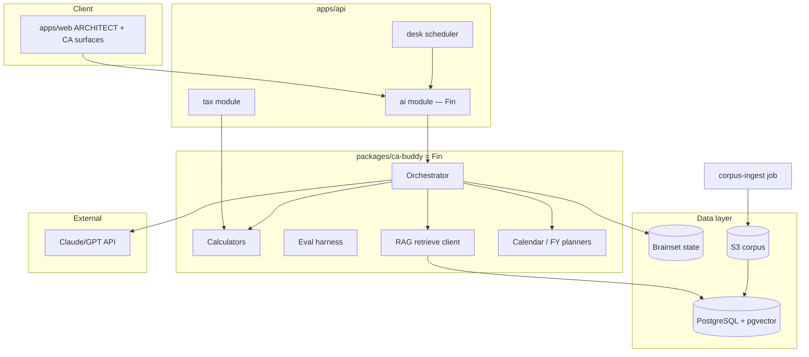

# CAPSTONE Technical Plan

**Status:** Canonical engineering reference — stack, environments, services, CI, and local vs cloud strategy.  
**Audience:** Engineers and coding agents.  
**Companion:** [`build-plan.md`](build-plan.md) (what/when), [`architecture.md`](architecture.md) (demo→prod migration), [`mastery.md`](mastery.md) (visual map).

---

## Principles

1. **Local first for truth** — Calculators, types, unit tests, golden evals run on laptop + CI (fast, free, deterministic).
2. **Cloud for integration & residency** — Staging/production in AWS `ap-south-1` only ([`anti-goals.md`](anti-goals.md)).
3. **Hybrid by design** — LLM APIs work from anywhere; corpus and user data stay in India in prod.
4. **One monorepo** — Shared types, calculators, and UI; services consume packages, don't fork logic.
5. **Fail closed** — No LLM tax math; no uncited legal claims; no anti-goal copy in UI or prompts.

---

## Environment strategy

| Environment | Purpose | Data | Where |
|-------------|---------|------|-------|
| **Local dev** | Fast iteration, unit tests, eval harness | Kapoor demo fixtures only | Developer laptop |
| **Local Docker** | RAG + DB integration dev | Synthetic + demo corpus | `docker compose` |
| **CI** | Gate every PR | Demo fixtures + golden evals | GitHub Actions |
| **Staging** | End-to-end integration, LLM evals | Synthetic + demo; no real PII | AWS `ap-south-1` |
| **Production** | Pilot families | Real data, consent-bound | AWS `ap-south-1` |

### Local vs cloud — decision matrix

| Workload | Build locally | Build on cloud |
|----------|---------------|----------------|
| `packages/ca-buddy` Fin calculators | **Yes** | No |
| Golden eval harness (no LLM) | **Yes** | CI only |
| Golden eval with LLM | Optional local | **Staging (nightly)** |
| pgvector RAG dev | **Docker local** | Staging for shared corpus |
| `apps/api` NestJS services | **Yes** (local PG via Docker) | Staging for integration |
| Fin orchestrator + desk jobs | Local against staging API | **Staging** |
| Live CBDT circular scrape | No | **Cloud jobs only** |
| Fine-tune (Phase B6) | No | **Cloud GPU** |
| Real portfolio / PII | **Never local** | Production only |

**Rule:** Defer AWS spend until Phase B3 (RAG) or A1 (live API) — whichever comes first. Phases B0–B2 and doc work are 100% local.

---

## Tech stack (locked)

From [`product-bible.md`](product-bible.md) §8 — do not swap without updating this doc.

| Layer | Technology | Notes |
|-------|------------|-------|
| Web | Next.js 15 (`apps/web`) | Exists; SSR dashboards |
| Mobile | React Native | Sprint A3; read-only beta first |
| API | NestJS (`apps/api`) | TypeScript; microservice modules in one repo first |
| Language | TypeScript 5.x | Node ≥20; pnpm workspaces |
| Primary DB | PostgreSQL 16 | Entities, users, permissions, tax ledger |
| Time-series | TimescaleDB extension | Portfolio snapshots, price history |
| Cache / queue | Redis + BullMQ | Sessions, job queues |
| Object storage | S3 (ap-south-1) | Documents, vault, corpus artifacts |
| Vector search | pgvector (PostgreSQL) | Legal corpus for Fin RAG |
| AI reasoning | Claude or GPT via API | Orchestrator only; not for arithmetic |
| Embeddings | Provider API or local model | Same region policy as staging/prod |
| Infra | AWS Mumbai (`ap-south-1`) | **Mandatory** for staging + prod |
| Secrets | AWS Secrets Manager + KMS | No secrets in git; no plain-text IT creds |
| CI | GitHub Actions | Every PR |
| IaC | Terraform (`infra/`) | Sprint A1+ |

**Not in stack:** Kubernetes for MVP (use ECS Fargate or single EC2 + Docker for staging). Pinecone optional — prefer pgvector to reduce moving parts.

---

## Repository layout (target)

```
HNI/
├── apps/
│   ├── web/                    # Next.js demo → production UI
│   └── api/                    # NestJS: gateway + service modules
│       └── src/
│           ├── wealth/
│           ├── tax/
│           ├── ingestion/
│           ├── ai/             # Fin ask + desk
│           ├── vault/
│           └── advisor/
├── packages/
│   ├── types/                  # Shared contracts
│   ├── demo-data/              # Kapoor fixtures — never real PII
│   ├── ui/                     # Design system
│   └── ca-buddy/               # Fin: calculators, evals, orchestrator, desk seeds
│       ├── src/
│       │   ├── calculators/
│       │   ├── evals/
│       │   ├── orchestrator/
│       │   ├── calendar/
│       │   ├── fy/
│       │   └── rag/            # Client; corpus ingest in api or jobs
│       └── evals/golden/       # Scenario JSON
├── infra/
│   ├── docker-compose.yml      # Local PG + pgvector + Redis
│   └── terraform/              # Staging + prod ap-south-1
├── docs/                       # Start with mastery.md
└── .github/workflows/ci.yml
```

---

## Microservices (logical boundaries)

Start as **NestJS modules** in one `apps/api` deploy; split to separate services only when load requires it.

| Module | Responsibility | Key APIs |
|--------|----------------|----------|
| `wealth` | Entity graph, net worth, holdings | `GET /family/networth`, `GET /entities/:id/holdings` |
| `tax` | Firewall, harvest, advance tax | `GET /tax/firewall/status`, `POST /tax/harvest/scan` |
| `ingestion` | AA, CAS, document parse | `POST /ingest/aa/consent`, `POST /ingest/cas` |
| `ai` | Fin ask + desk + scenarios | `POST /ai/ask`, `POST /ai/desk/run`, `POST /ai/scenario` |
| `vault` | If I'm Gone, nominees | `GET /vault/playbook`, `GET /vault/nominee-audit` |
| `advisor` | Permissions, audit, exports | `POST /advisor/invite`, `GET /audit/log` |
| `notification` | Push, email, WhatsApp | `POST /notify/action-card` |

**Fin** lives in `packages/ca-buddy` as a library imported by `ai` and `tax` modules — single source of tax math and desk planning. One **bible**; per-family **brainsets** (persisted later).

---

## Fin runtime architecture



### Request flow (`POST /ai/ask`)

1. Auth + audit log entry (no raw PII in logs)
2. Load **brainset** slice (entity graph, open mismatches, calendar)
3. Fin orchestrator: constitution check → intent → Mode A/B → sub-buddies
4. RAG retrieve (if legal claim needed)
5. Calculator tool calls (if numbers needed)
6. LLM synthesis with citations + tool traces
7. Action Card or consult-CA flag
8. Response + persist audit record

### Desk flow (`POST /ai/desk/run` or scheduled job) — B5+

1. Load brainset + portfolio diffs
2. Run sub-buddies → Day Plan
3. CA review pack → approve/edit/reject
4. HNI-facing Action Cards from CA-cleared items
5. Never auto-execute

**Hard gates:** Number without tool call → reject response. Legal claim without citation → refuse.

---

## Background jobs

| Job | Frequency | Module | Purpose |
|-----|-----------|--------|---------|
| `aa-sync` | 6h | ingestion | Refresh AA data |
| `ais-reconcile` | Nightly | tax | Tax Firewall scan |
| `harvest-scan` | Daily (market days) | tax / Fin | Harvest opportunities → Day Plan / Action Cards |
| `price-update` | 15 min (market hours) | wealth | Mark-to-market |
| `nominee-audit` | Weekly | vault | Nominee gaps |
| `advance-tax-reminder` | 7d before due | tax | Quarterly alerts |
| `fin-desk-daily` | Daily | ai / Fin | Brainset diff → sub-buddies → Day Plan → CA queue |
| `consent-expiry` | Daily | ingestion | AA consent renewal |
| `corpus-ingest` | Weekly + manual | ai | Stage new circulars → review → index |
| `golden-eval-llm` | Nightly | ca-buddy | Full LLM eval on staging |

---

## CI pipeline (implement in Phase C0)

### On every PR

```yaml
# .github/workflows/ci.yml (target)
- pnpm install
- pnpm typecheck
- pnpm lint
- pnpm --filter @capstone/ca-buddy test          # calculator unit tests
- pnpm --filter @capstone/ca-buddy eval:deterministic  # golden subset, no LLM
- anti-goal copy scan (forbidden phrases in apps/web + packages/ca-buddy)
```

### Nightly on staging

- Full golden eval with LLM (`eval:full`)
- Citation coverage report
- Red-team adversarial subset

### Pass bars

| Gate | Threshold |
|------|-----------|
| Calculator unit tests | 100% pass on P0 functions |
| Deterministic golden eval | ≥90% before ARCHITECT live swap |
| Full LLM golden eval | ≥85% before production ARCHITECT |
| Anti-goal phrase scan | 0 violations |

---

## Local development setup

### Prerequisites

- Node ≥20, pnpm 9.x
- Docker Desktop (Phase C1+)

### Commands (today)

```bash
pnpm install
pnpm dev                    # Next.js demo on :3000
pnpm typecheck
pnpm lint
```

### Commands (after packages/ca-buddy exists)

```bash
pnpm --filter @capstone/ca-buddy test
pnpm --filter @capstone/ca-buddy eval:deterministic
```

### Docker Compose (Phase C1)

```yaml
# infra/docker-compose.yml (target)
services:
  postgres:
    image: pgvector/pgvector:pg16
    ports: ["5432:5432"]
  redis:
    image: redis:7
    ports: ["6379:6379"]
```

---

## Cloud setup (staging — Phase C2)

| Resource | Spec (staging) | Region |
|----------|----------------|--------|
| ECS Fargate or EC2 | 1× `ai-service` + 1× `api` | ap-south-1 |
| RDS PostgreSQL | db.t4g.medium + pgvector | ap-south-1 |
| ElastiCache Redis | cache.t4g.micro | ap-south-1 |
| S3 | Corpus + documents bucket | ap-south-1 |
| Secrets Manager | LLM keys, DB creds | ap-south-1 |
| KMS | Encryption at rest | ap-south-1 |

**Estimated staging cost:** ~₹8–15k/month (rough; scale down when idle).

Production mirrors staging with larger RDS, multi-AZ, and WAF — same region only.

---

## Security posture

| Measure | Demo (now) | Staging / prod |
|---------|------------|----------------|
| Encryption at rest | N/A | AES-256 KMS |
| Encryption in transit | HTTPS | TLS 1.2+ |
| PII in repo | Forbidden | Forbidden |
| IT portal credentials | N/A | Encrypted, consent-bound; never plain text |
| Engineer access to raw finance data | N/A | Break-glass only, audited |
| Data residency | Local dev OK | **India only** |
| Model training on user data | N/A | Opt-in only; default off |
| Conversation audit | N/A | Required for ARCHITECT |

---

## Integration boundaries

| Integration | MVP | Method | Anti-goal note |
|-------------|-----|--------|----------------|
| Account Aggregator | A1 | TSP API | Consent-first |
| CAS (Zerodha/Groww) | A2 | PDF parse + API where available | Instructions only |
| AIS / 26AS | A2 | Manual upload v1 | Not ITR filing |
| IT portal API | Post-MVP | Consent + encrypted session | Reconciliation only |
| Broker trade API | Never | — | No execution |
| MF purchase | Never | — | Not a distributor |

---

## Testing strategy

```
                    ┌─────────────────────┐
                    │  Red-team (LLM)     │  staging nightly
                    ├─────────────────────┤
                    │  Golden eval (LLM)  │  staging nightly
                    ├─────────────────────┤
                    │  Golden deterministic│  every PR
                    ├─────────────────────┤
                    │  Integration (API)  │  staging on merge
                    ├─────────────────────┤
                    │  Unit (calculators) │  every PR
                    └─────────────────────┘
```

- **Never** call LLM in calculator unit tests.
- **Always** use Kapoor demo fixtures or synthetic data in CI — never real PAN/AIS in git.

---

## Deployment

| App | Demo | Staging / prod |
|-----|------|----------------|
| `apps/web` | Vercel or local | Vercel / CloudFront → ap-south-1 API |
| `apps/api` | Local | ECS Fargate ap-south-1 |
| Migrations | Local Docker | CI → staging → prod pipeline |

Demo credential `capstone2026` is **demo only** — replace with OAuth2 before pilots.

---

## What to build next (engineering)

Per [`build-plan.md`](build-plan.md), immediate technical work:

1. **C0** — Add `.github/workflows/ci.yml` + `packages/ca-buddy` scaffold
2. **B1** — P0 calculators with unit tests
3. **B2** — Golden eval JSON + deterministic harness
4. **A1** — `apps/api` skeleton when ready for live AA

*Update this doc when stack choices or environment strategy change.*
